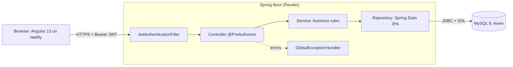
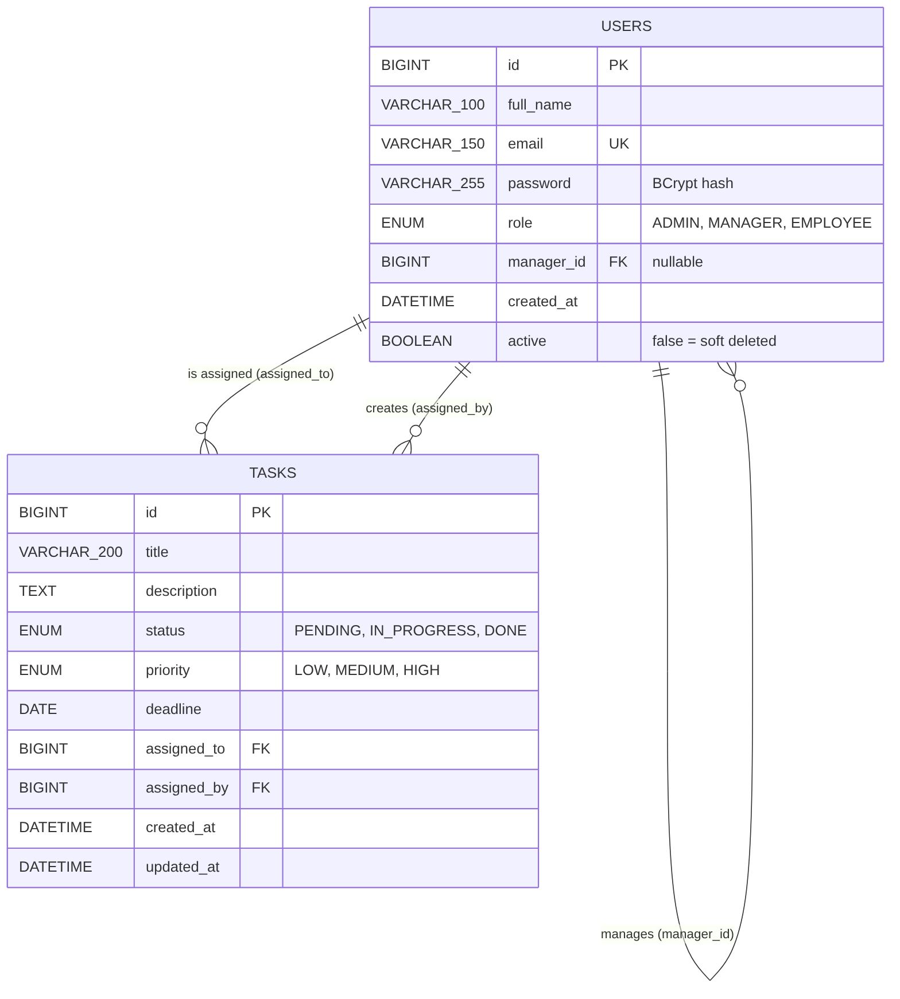

# Mini Employee & Task Management System

A full-stack, role-based web application. Three kinds of users (**Admin**, **Manager**, **Employee**) work with the same
data but see and may do different things. Access control is enforced **on the backend** with `@PreAuthorize`
(the Angular menu only hides links for convenience).

| Role | Can do |
|---|---|
| **ADMIN** | Create / edit / delete users, change roles, see **all** tasks (filter by user / role), edit or delete any task, download the PDF report of all tasks |
| **MANAGER** | Assign tasks to employees of **their own team**, see only the tasks they assigned (progress), edit their tasks, download the PDF report of **their team** |
| **EMPLOYEE** | See only **their own** tasks and move them forward `PENDING -> IN_PROGRESS -> DONE`. Cannot see any other user's data |

## Live demo

| | URL |
|---|---|
| Frontend (Netlify) | `<add your URL>` |
| Backend (Render) | `<add your URL>` (open `/api/health` first - a free server sleeps and needs ~1 minute to wake up) |
| Database | MySQL 8 on Aiven (free plan) |

## Tech stack

Java 17 · Spring Boot 3.5 · Spring Security (JWT, stateless) · Spring Data JPA / Hibernate · MySQL 8 · OpenPDF ·
Angular 13 · Bootstrap 5 · ng-bootstrap · TypeScript · Maven · Angular CLI · Docker · Git

## Architecture



```
backend/src/main/java/com/fifotech/taskmanager
 ├─ controller   thin REST layer: input validation + @PreAuthorize (WHICH ROLE may call)
 ├─ service      business rules (WHICH ROWS a role may touch), transactions
 ├─ repository   Spring Data JPA + Specifications (dynamic filters)
 ├─ entity       JPA entities (never sent to the client)
 ├─ dto          request / response records (what the API exposes)
 ├─ mapper       entity -> DTO
 ├─ security     JWT service, JWT filter, UserDetails, 401/403 handlers
 ├─ config       Spring Security + CORS configuration
 ├─ exception    custom exceptions + @RestControllerAdvice (GlobalExceptionHandler)
 └─ enums        Role, TaskStatus (with the allowed transition), TaskPriority

frontend/src/app
 ├─ core         models, services (API calls), AuthGuard / GuestGuard, JWT + error interceptors
 ├─ shared       navbar, toast, confirm dialog, badges
 └─ features     auth, dashboard, users, tasks, my-tasks, reports (lazy-loaded modules)
```

Request flow: `Browser -> JwtAuthenticationFilter -> Controller (@PreAuthorize) -> Service -> Repository -> MySQL`.
Errors from any layer are turned into one JSON shape by `GlobalExceptionHandler`.

### Design decisions

* **Stateless JWT (HS256).** The token holds email, user id and role. The filter reloads the user from the DB on every
  request, so a role change or a deleted user takes effect immediately.
* **Soft delete.** Deleting a user sets `active = false` (the user cannot log in and disappears from lists). Task history
  stays intact and no foreign key breaks. A manager who still has team members cannot be deleted; nobody can delete themselves.
* **Status workflow.** An employee can only move a task one step forward. Skipping or going back returns `400`.
* **Manager scope.** A manager can only assign to employees whose `manager_id` is that manager. Their task list shows tasks
  they created, and their report contains the tasks of their team.
* **Passwords** are BCrypt hashes. The login error message is the same for an unknown email, a wrong password and a disabled account.
* **Schema is owned by `schema.sql`**; Hibernate runs with `ddl-auto=none`.
* **CORS** allows only the origins listed in `CORS_ALLOWED_ORIGINS`.

## Sample login credentials (seed data in `schema.sql`)

| Email | Password | Role |
|---|---|---|
| admin@demo.com | Admin@123 | ADMIN |
| manager@demo.com | Manager@123 | MANAGER (team: emp1, emp2) |
| emp1@demo.com | Emp@123 | EMPLOYEE |
| emp2@demo.com | Emp@123 | EMPLOYEE |

## Local setup

### Option A - Docker (easiest)
```bash
docker compose up --build        # MySQL + backend (schema.sql is loaded automatically)
cd frontend && npm install && npm start    # http://localhost:4200
```

### Option B - without Docker
Requirements: **JDK 17**, **Maven 3.9+**, **MySQL 8**, **Node 16** (Angular 13 needs Node 14 or 16) and Angular CLI 13.

1. **Database**
   ```bash
   mysql -u root -p < schema.sql        # creates database "taskdb", tables and seed data
   ```
2. **Backend**
   ```bash
   cd backend
   export DB_URL="jdbc:mysql://localhost:3306/taskdb?useSSL=false&allowPublicKeyRetrieval=true&serverTimezone=UTC"
   export DB_USERNAME=root
   export DB_PASSWORD=your-mysql-password
   export JWT_SECRET="$(openssl rand -base64 48)"
   mvn spring-boot:run                  # http://localhost:8080/api/health
   ```
   (Windows PowerShell: `$env:DB_PASSWORD="..."` instead of `export`.)
3. **Frontend**
   ```bash
   cd frontend
   npm install
   npm start                            # http://localhost:4200 (talks to http://localhost:8080/api)
   ```
4. **Tests** (in-memory H2, no MySQL needed): `cd backend && mvn verify`

## Environment variables (backend)

| Variable | Required | Example / default | Meaning |
|---|---|---|---|
| `DB_URL` | yes (prod) | `jdbc:mysql://host:3306/db?sslMode=REQUIRED&serverTimezone=UTC` | JDBC URL. Defaults to local `taskdb` |
| `DB_USERNAME` | yes (prod) | `root` | DB user |
| `DB_PASSWORD` | yes (prod) | - | DB password (never commit it) |
| `JWT_SECRET` | **yes** | 32+ random characters | HS256 signing key. The app refuses to start without it |
| `JWT_EXPIRATION_MS` | no | `3600000` (1 h) | Token lifetime. The frontend logs the user out when it expires |
| `CORS_ALLOWED_ORIGINS` | yes (prod) | `https://my-app.netlify.app` | Comma separated list of allowed frontend origins, no trailing slash |
| `PORT` | no | `8080` | Injected by Render / Railway |
| `DB_POOL_SIZE` | no | `5` | Connection pool size (free cloud DBs allow few connections) |

Frontend: `API_URL` (only at build time, used by `npm run build:prod`) e.g. `https://my-api.onrender.com/api`.

## API documentation

Base URL `http://localhost:8080`. All endpoints except login and health need `Authorization: Bearer <token>`.
Errors always look like `{ timestamp, status, error, message, path, fieldErrors? }`.

| Method | Endpoint | Roles | Description | Success |
|---|---|---|---|---|
| POST | `/api/auth/login` | public | Login, returns `{ token, role, name }` | 200 (401 wrong credentials) |
| POST | `/api/auth/register` | ADMIN | Create a user (same as `POST /api/users`) | 201 |
| GET | `/api/users?search=&page=&size=` | ADMIN | Paginated user list, search by name / email | 200 |
| GET | `/api/users/{id}` | ADMIN | One user | 200 |
| POST | `/api/users` | ADMIN | Create user `{fullName,email,password,role,managerId?}` | 201 |
| PUT | `/api/users/{id}` | ADMIN | Edit user / change role (password optional) | 200 |
| DELETE | `/api/users/{id}` | ADMIN | Soft delete | 204 |
| GET | `/api/users/assignees` | ADMIN, MANAGER | Employees the caller may assign to (admin: all, manager: own team) | 200 |
| GET | `/api/users/managers` | ADMIN | Managers for the user form drop-down | 200 |
| POST | `/api/tasks` | ADMIN, MANAGER | Create + assign `{title,description?,deadline?,priority?,assignedTo}` | 201 |
| GET | `/api/tasks?status=&priority=&assigneeId=&assignedByRole=&search=&page=&size=` | all | **Role-filtered** list (admin: all, manager: assigned by me, employee: assigned to me) | 200 |
| GET | `/api/tasks/{id}` | all | One task (only if visible to the caller) | 200 / 403 / 404 |
| PUT | `/api/tasks/{id}` | ADMIN, MANAGER | Edit task (manager: only own tasks and own team) | 200 |
| PUT | `/api/tasks/{id}/status` | EMPLOYEE | `{status}` - own task, one step forward only | 200 / 400 / 403 |
| DELETE | `/api/tasks/{id}` | ADMIN | Delete task | 204 |
| GET | `/api/dashboard/stats` | all | Role based numbers | 200 |
| GET | `/api/reports/tasks/pdf` | ADMIN, MANAGER | PDF stream (admin: all, manager: own team) | 200 (403 for employees) |
| GET | `/api/health` | public | Liveness probe | 200 |

HTTP status codes used: 200, 201, 204, 400 (validation / business rule), 401 (no / invalid / expired token, wrong login),
403 (role or ownership), 404, 409 (duplicate email, manager still has a team), 500.

A ready-made Postman collection is in [`postman/`](postman/Task-Management.postman_collection.json): run it with the Collection Runner
(the login requests save the tokens automatically). Set the `baseUrl` collection variable for the live server.

## Database

`schema.sql` creates the tables (`users`, `tasks`) and inserts the seed data (BCrypt hashes).
Backup / restore helpers: `scripts/backup-db.sh` and `scripts/restore-db.sh`.



## Documentation (`/docs`)

* Use case diagram - `docs/diagrams/use-case.png` (source `use-case.svg`)
* Class diagram - `docs/diagrams/class-diagram.png` (source `class-diagram.mmd`)
* ER diagram - `docs/diagrams/er-diagram.png` (source `er-diagram.mmd`)
* Screenshots - `docs/screenshots/`
* Deployment guide - [`DEPLOYMENT.md`](DEPLOYMENT.md)

## Tests

`backend/src/test/.../RbacIntegrationTest.java` starts the whole application against in-memory H2 and checks login, 401, 403,
role-filtered lists, team rules, the status workflow, validation, soft delete, dashboard and the PDF report.
